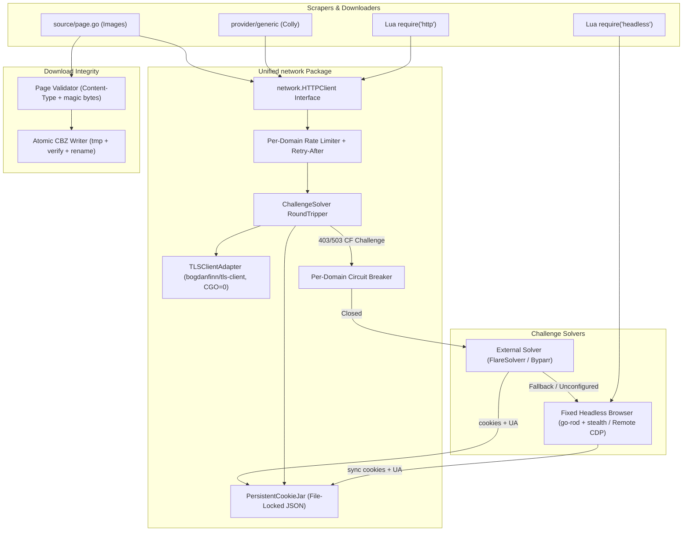
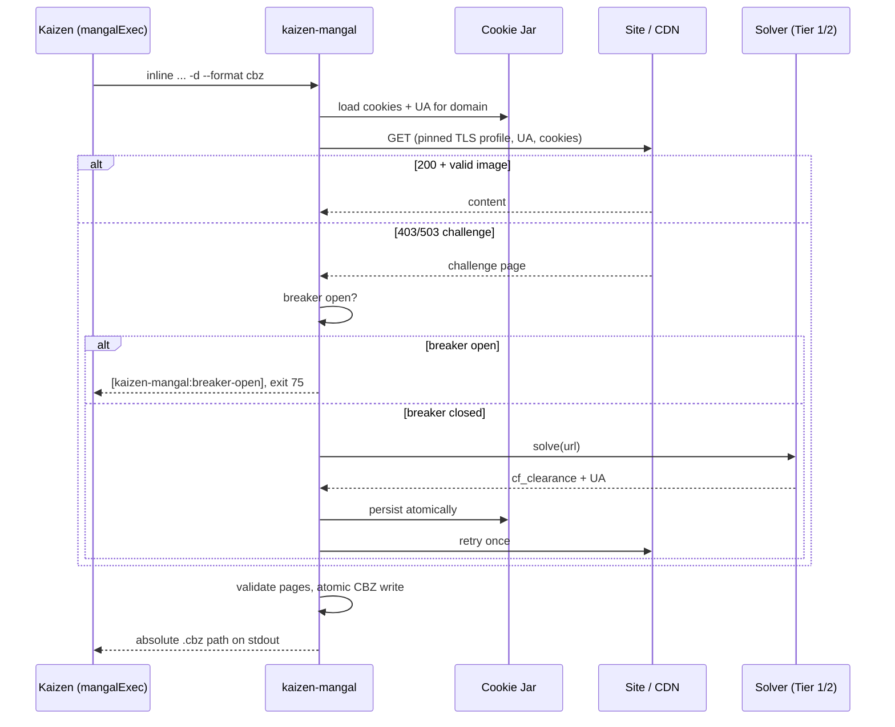
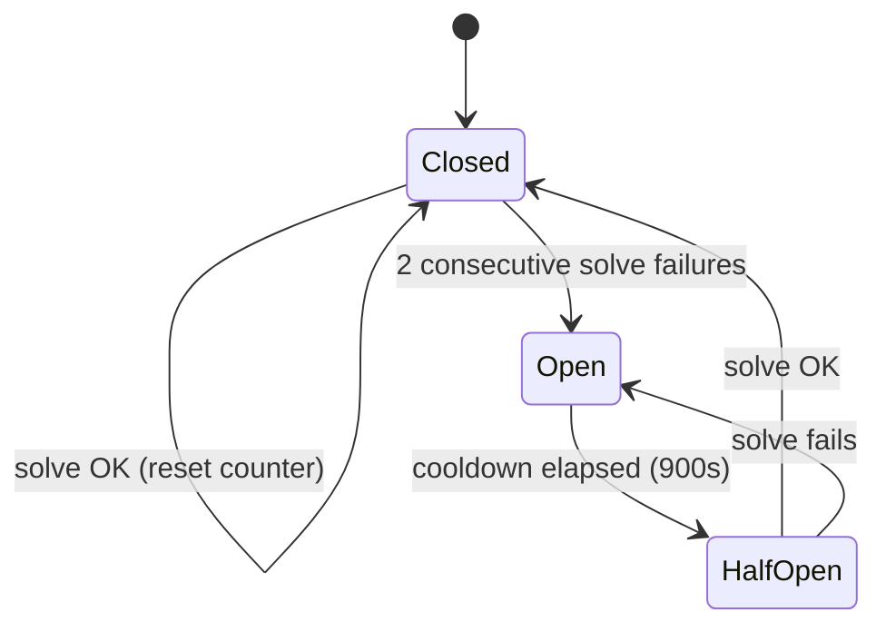

# [RFC 0001] Network Resilience, Download Integrity, Headless Fix & Toolchain Modernization

- **ID:** RFC 0001
- **Title:** Network Resilience, Download Integrity, Headless Browser Fix, Kaizen Integration & Toolchain Modernization
- **Status:** 📝 `DRAFT` — open for comments
- **Author:** d4nj3s & Kaizen Core Team
- **Date:** 2026-11-19
- **Objective:** Turn the unmodified `mangal v4.0.6` import into a resilient, Kaizen-owned scraping core that downloads reliably behind modern WAFs and never reports a corrupt chapter as downloaded.
- **Repository:** `github.com/kaizen-Architecture/kaizen-mangal`
- **Baseline:** unmodified import of `metafates/mangal v4.0.6` (commit `a6be0fa`)
- **Process:** follows [Kaizen RFC 0000 — RFC Process & Architectural Governance](https://github.com/kaizen-Architecture/Kaizen/blob/main/docs/rfcs/0000-rfc-process.md)

> [!NOTE]
> **Baseline context for reviewers.** At the time of writing, `kaizen-mangal` contains **zero modifications**: it is a clean import of upstream `mangal v4.0.6` (upstream archived/read-only since April 2025). Every defect described in Section 1 is **inherited from upstream** and **affects Kaizen in production today**, because Kaizen currently ships that exact upstream binary. This RFC defines how the fork evolves into the Kaizen scraping core.

---

## 0. How to Review This RFC

- Comment inline on the Pull Request that introduces this document. One topic per comment thread, please.
- Section 13 lists **Open Questions** where a decision is explicitly requested from reviewers.
- Line references (`file.go:NN`) point to the baseline commit `a6be0fa`. Kaizen references point to `kaizen-Architecture/Kaizen@main`.

> [!NOTE]
> **Scope of this project.** `kaizen-mangal` is a general-purpose scraping engine: an HTTP/TLS stack, a headless browser bridge, a Lua runtime and a verified downloader. It contains no site-specific logic. Which sites a user targets, and whether they are entitled to access them, is the user's responsibility and outside the scope of this RFC.

---

## 1. Motivation & Problem Statement

`kaizen-mangal` is the scraping and download engine of the Kaizen ecosystem. Kaizen invokes it as a short-lived CLI subprocess (up to 3 concurrent processes) for search, chapter listing and downloads. Running unmodified v4.0.6 against modern manga sources fails due to the following structural issues, all confirmed in the repository.

### 1.1 Fragmented HTTP Stack & Trivially Fingerprinted TLS
The codebase maintains **three disconnected HTTP clients**, none of which perform browser TLS/HTTP2 impersonation:

1. **Image & Core Downloader (`network/client.go`, `source/page.go`)**
   - Uses standard `net/http.DefaultTransport` (Go's default JA3/JA4 TLS ClientHello and HTTP/2 SETTINGS frame).
   - Has `Jar: nil` — cookies acquired during scraping are never sent when downloading chapter images (`source/page.go:58`).
   - Sends an outdated hardcoded User-Agent: `Chrome/104.0.0.0` (`constant/meta.go:6`).
2. **Generic Scraper Engine (`provider/generic/new.go`)**
   - Uses `colly.NewCollector` with Colly's default `net/http` transport and `Chrome/104.0.0.0`.
   - Sets `r.Headers.Set("Host", s.config.BaseURL)` (`provider/generic/new.go:37,75`), injecting a full URL scheme into the `Host` header.
3. **Custom Lua Scrapers (`vendor/github.com/metafates/mangal-lua-libs/http/client/client.go`)**
   - Allocates a fresh `http.Transport{}` per `http.client()` call with default Go TLS and `Chrome/106.0.0.0`.
   - Uses an ephemeral in-memory `cookiejar.Jar` per Lua client instance that is discarded on process exit and **never shared** with `network.Client`.

Modern WAFs (Cloudflare, DDoS-Guard, Akamai) reject these requests with `403 Forbidden` or JS/Turnstile challenges. Even when a Lua scraper clears a challenge, `source/page.go` fails to download images due to missing cookies and mismatched TLS/User-Agent fingerprints. These failures are generic: they affect any Lua scraper whose target sits behind a modern WAF, regardless of the site.

### 1.2 Broken Headless Browser & Concurrency Hazards
1. **Destructive global temp wipes:**
   - `vendor/github.com/metafates/mangal-lua-libs/headless/browser.go:17-18` runs `os.RemoveAll(filepath.Join(os.TempDir(), "rod"))` on every `headless.browser()` call.
   - `cmd/root.go:67-70` spawns `go func() { _ = util.Delete(where.Temp()) }()` on **every CLI startup**, deleting active temp files of concurrent Kaizen workers mid-download.
2. **Obsolete `go-rod/rod v0.112.3` (2022) & broken container support (`browser.go:20-21`):**
   - Attempts to download an ancient Chromium revision; lacks `--no-sandbox` / `--disable-dev-shm-usage`, system browser discovery (`launcher.LookPath()`), custom binary override and remote CDP WebSocket support. In Kaizen this surfaces as `Headless.browser()` returning `nil` and `Browser:page()` failing with "attempt to index a non-table object".
3. **Zombie browser leaks (`browser.go`, `page.go`):** neither `browser` nor `browserPage` exposes `close()`, and `luaSource` (`provider/custom/source.go`) has no cleanup hook.
4. **Uncaught Go panics & infinite hangs (`page.go:35-133`):** every operation calls `Must*` (`MustPage`, `MustWaitLoad`, `MustElement`, `MustElements`, `MustEval`, `MustHTML`, `MustWaitElementsMoreThan`) without timeouts, crashing the CLI with Go stack traces instead of returning Lua errors.
5. **No stealth evasion & no cookie bridge:** exposes `navigator.webdriver = true` and cannot transfer solved cookies back to the HTTP stack.

### 1.3 Inherited Download Integrity Defects
These defects violate Kaizen's Golden Rule 5 ("files are verified before database commitment") and can silently corrupt a library:

1. **Partial or corrupt CBZ files are treated as successfully downloaded — forever.**
   - `converter/cbz/cbz.go:43-52` creates the archive **directly at its final path** and discards the error from `zipWriter.Close()` (the call that writes the ZIP central directory) and from `cbzFile.Close()`. A truncated or structurally invalid archive is reported as success.
   - If writing fails midway, the partial file stays at the final path.
   - `source/chapter.go:138-147` (`IsDownloaded`) only checks that the file **exists**. On the next run, `downloader/download.go:36-38` skips the chapter ("already downloaded") and prints its path to stdout, so Kaizen records it as valid.
2. **WAF challenge pages are stored as images.** `source/page.go:66-98` only checks for HTTP `200`. It never inspects `Content-Type` or the payload's magic bytes, so an HTML challenge served with `200` by an image CDN ends up inside the CBZ as `0001.jpg`.
3. **Data races and panics in the page downloader** (`source/chapter.go:47-95`, with `downloader.async = true` by default):
   - All page goroutines write to the shared named return `err` and to `c.size` without synchronization (data race; flagged by `go test -race`).
   - A `nil` page triggers `fmt.Errorf("page #%d ...", page.Index)` on a nil pointer → panic.
   - A page with an empty URL returns `nil` without content (`source/page.go:46-49`); `addToZip` then calls `io.Copy` on a nil `*bytes.Buffer` → panic.

### 1.4 Kaizen Integration Gaps
Verified against `kaizen-Architecture/Kaizen@main`:

1. **Lua "syntax validation" does not compile Lua.** Kaizen's AI scraper generator validates new scrapers by checking whether the name appears in `sources list -r` (`src/server/trpc/router/sources.ts:948-952`). `provider.Customs()` (`provider/provider.go:30-71`) only lists `*.lua` file names and never compiles them, so a scraper with syntax errors or missing required functions passes validation. The comparison is also case-insensitive, so a custom `mangadex.lua` collides with the built-in `Mangadex` provider and passes even if the file failed to load.
2. **Kaizen treats built-in providers as active sources.** `src/server/trpc/router/manga.ts:74-79` merges `sources list -r` output (built-ins `Mangadex`, `Manganato`, `Manganelo`, `Mangapill`) with on-disk `.lua` files to decide which sources are active. Removing built-ins would mark every manga bound to them as inactive and feed `trackSourceFailure()` until auto-deactivation.
3. **Container bootstrap is hardwired to `mangal`.** `docker/root/etc/cont-init.d/40-config:19-32` copies `/mangal` into `/config/.config/`, runs `mangal config set --key formats.use --value cbz` and cleans `/config/.cache/mangal/...`; `docker/Dockerfile:104` sets `MANGAL_FORMATS_USE=cbz`.
4. **Source directory management depends on `where -s`.** `src/server/utils/sources.ts:117-120,153` and `src/server/trpc/router/manga.ts:65-72` resolve the sources directory via `where -s` and disable scrapers by moving them into `disabled/` and `disabled/failed/` subfolders.

### 1.5 Vendored External Lua Libraries & Live-Site Coupling
- `github.com/metafates/mangal-lua-libs v0.5.0` is locked inside `vendor/`, blocking clean ownership of `http` and `headless`.
- Existing upstream tests (`provider/manganato/manganato_test.go`, `manganelo_test.go`, `mangapill_test.go`, `mangadex/search_test.go`) hit real live manga websites, and `config/default.go:317-330` hardcodes `metafates/mangal-scrapers` as the default scraper repository.

### 1.6 Obsolete Go Toolchain & Upstream-Coupled CI/CD
- `go.mod` targets `go 1.18` (EOL) and `module github.com/metafates/mangal`.
- `.github/workflows/test.yml`, `release.yml` and `.goreleaser.yaml` use deprecated v2/v3 actions, single-arch Docker (`linux/amd64`), and push to upstream `metafates` registries.
- `version/notify.go` queries upstream `metafates/mangal` GitHub releases on `--help` and `--version`.

---

## 2. Alternatives Considered

| Alternative | Verdict | Reason |
|---|---|---|
| Keep upstream `metafates/mangal v4.0.6` unmodified | ❌ Rejected | Archived (read-only since April 2025). No fixes will ever land for any issue in Section 1. |
| `luevano/mangal` (community `v5` fork) | ❌ Rejected | Full architectural rewrite with a different CLI and output contract; not a drop-in replacement for Kaizen's `mangal.ts` integration, and we would not control its roadmap. |
| `manga-py` | ❌ Rejected | Archived since April 2024; its author recommends `gallery-dl`. Most providers are stale. |
| `gallery-dl` as the primary engine | ❌ Rejected as replacement | No search-by-title (URL-driven only), per-extractor JSON schemas, Python runtime, and its `requests` stack hits the same Cloudflare fingerprinting wall. Would require rewriting Kaizen's catalog/search layer. |
| `gallery-dl` as a secondary "add by URL" backend | ⏸️ Deferred | Potentially valuable later behind a provider interface in Kaizen; out of scope for this RFC. |
| Suwayomi / Tachiyomi-extension runtime | ⏸️ Deferred | JVM-based and heavy for 2 GB homelab hosts; different extension model. |
| **Own fork of `mangal v4.0.6` (`kaizen-mangal`)** | ✅ **Chosen** | Preserves the CLI/JSON contract and the existing Lua scraper ecosystem while giving us full control of the HTTP, headless and download layers, where the failures actually live. Fixes land once in the core and benefit every Lua scraper without touching Lua code. |

---

## 3. Goals, Constraints & Non-Goals

### Goals
- **Unified HTTP & TLS Impersonation:** route `network.Client`, `provider/generic` (Colly) and Lua `require("http")` through a single swappable `network.HTTPClient` interface backed by `bogdanfinn/tls-client` (`CGO_ENABLED=0`).
- **Persistent Shared Cookie Jar:** share cookies (`cf_clearance`, sessions) across Lua scrapers, Go image downloaders and concurrent CLI subprocesses safely.
- **Deterministic Challenge Handling:** external solver (FlareSolverr / Byparr) as Tier 1 and fixed headless `go-rod` as Tier 2 fallback, guarded by a per-domain circuit breaker.
- **Download Integrity (fail closed):** never print a chapter path to stdout unless the archive is complete, structurally valid and contains only real images.
- **Production-Grade Headless Browser:** eliminate temp-dir race conditions, panics, zombie processes and Docker failures; add stealth, timeouts, remote CDP and cookie sync.
- **Additive-Only Lua API:** every existing Lua module and function keeps its name, signature and return shape; new capabilities are additions only.
- **Kaizen-First Core:** add machine-readable commands Kaizen needs (`version --json`, `sources validate --json`, `doctor --json`, structured errors) once the drop-in phase is complete.
- **Zero-CGO Static Multi-Arch Builds:** `CGO_ENABLED=0` binaries (`linux/amd64`, `linux/arm64`, `darwin/amd64`, `darwin/arm64`, `windows/amd64`) and GHCR multi-arch Docker images (minimal + `-chromium`), with Kaizen's two-tier release model (staging + stable).

### Hard Constraints
- **No site-specific logic is maintained or distributed by this project.** `kaizen-mangal` is a scraping *engine*: it ships no curated list of sites and no project-maintained scrapers. Lua scrapers are supplied by the user (hand-written, or generated on demand by Kaizen from a URL the user provides). The four inherited upstream built-in providers (`Mangadex`, `Manganato`, `Manganelo`, `Mangapill`) stay untouched during Stage 1 solely for drop-in parity, and are removed in Phase 9 with no replacement list maintained by this project.
- **Offline, deterministic tests only:** CI tests use local `httptest.Server` instances or static fixtures, never real site URLs. Inherited live-site tests are deleted or moved behind a `//go:build live` tag that CI never runs.
- **Original attribution preserved:** retain the original MIT `LICENSE` and upstream attribution notices from `metafates/mangal` and `metafates/mangal-lua-libs`.
- **Frozen CLI/JSON contract during migration (Stages 1–2):** byte-compatible with what Kaizen parses today (Section 6.F.2). After migration, the contract may evolve **only** through an explicit `contract_version` bump agreed with Kaizen.

### Non-Goals
- Rewriting the Bubble Tea TUI or the AniList integration.
- Integrating paid third-party human CAPTCHA-solving services in v1.
- Support for enterprise bot-management systems and interactive CAPTCHAs. Best effort only.
- Maintaining, curating or publishing lists of supported sites or ready-made scrapers for specific sites.
- Multi-backend engines (`gallery-dl`, Suwayomi) — see Section 2.

---

## 4. Design & Resilience Principles

1. **Deterministic first (Kaizen Layer 1):** challenges, retries and rate limits are handled with fixed rules, TTLs and circuit breakers. No AI is involved inside the core.
2. **Fail closed on integrity:** an incomplete chapter is an error, never a success. Stdout carries a path only for verified archives.
3. **Atomic state changes:** every file the core writes (CBZ, cookie jar, breaker state) is written to a temp file in the same directory and published with `rename`.
4. **No cross-process collateral damage:** a process may only delete files it created. Global temp wipes are forbidden.
5. **Wipe tolerance:** state files may disappear at any moment (Kaizen "Clear Cache"). Missing state equals empty state.
6. **Additive compatibility:** Lua API, config keys and CLI output only grow; nothing is renamed or removed without a contract bump.
7. **Single source of truth for identity:** TLS profile, HTTP/2 settings, User-Agent and client hints always come from one coherent browser profile.

---

## 5. Proposed Architecture



---

## 6. Pillars

### Pillar A: Internalize `mangal-lua-libs` & Guarantee Lua API Compatibility

1. Copy `vendor/github.com/metafates/mangal-lua-libs/*` into `internal/lualibs/` (preserving `internal/lualibs/LICENSE`).
2. Update `provider/custom/loader.go` and internal imports to `github.com/kaizen-Architecture/kaizen-mangal/internal/lualibs/...`.
3. Remove `github.com/metafates/mangal-lua-libs` from `go.mod` and delete the `vendor/` directory.
4. Wire `internal/lualibs/http` directly to `network.NewClient(...)`.
5. **Lua API compatibility guarantee:**
   - The preloaded modules (`base64`, `crypto`, `filepath`, `goos`, `headless`, `html`, `http`, `humanize`, `inspect`, `io`, `ioutil`, `json`, `log`, `regexp`, `runtime`, `shellescape`, `stats`, `storage`, `strings`, `template`, `time`, `xmlpath`, `yaml`) keep every existing function name, argument order and return shape.
   - The required scraper globals (`SearchManga`, `MangaChapters`, `ChapterPages`, `provider/custom/definitions.go`) and their result tables are unchanged.
   - New functions (e.g. `browser:close()`, `page:close()`, `browser:sync_cookies()`) are additive only.
   - **Baseline first:** before any refactor, Phase 1 captures golden conformance tests of the current Lua API behavior against local fixtures. Every later phase must keep them green.
6. **Source loader invariant:** `provider.Customs()` keeps reading **only the top level** of the sources directory (`ReadDir` + `.lua` filter, `provider/provider.go:30-42`). Kaizen relies on this to park scrapers in `disabled/` and `disabled/failed/`. A regression test locks this behavior.

---

### Pillar B: Swappable `network.HTTPClient` & TLS Impersonation (`network/`)

#### Swappable Interface (`network/http_client.go`)
Define our own narrow interface so the underlying TLS library can be replaced without touching callers:

```go
type HTTPClient interface {
    Do(req *http.Request) (*http.Response, error)
    SetProxy(proxyURL string) error
    SetTimeout(d time.Duration)
    SetInsecureSkipVerify(skip bool)
    Jar() http.CookieJar
}
```

#### Implementation (`network/tls_client.go`)
- Backed by `github.com/bogdanfinn/tls-client` (pure Go, verified `CGO_ENABLED=0` across `linux/amd64`, `linux/arm64`, `darwin/*`, `windows/*`).
- Exposes both `network.HTTPClient` and a standard `http.RoundTripper` adapter so `colly.WithTransport(...)` and `source/page.go` share the exact same engine.

#### Synchronized Browser Profile (`network/profile.go`)
- Single source of truth for TLS profile, HTTP/2 frame profile, `User-Agent`, `Sec-Ch-Ua`, `Sec-Ch-Ua-Mobile`, `Sec-Ch-Ua-Platform` and `Accept-Language`.
- Configurable via `network.impersonate` / `KAIZEN_MANGAL_NETWORK_IMPERSONATE`.
- **Pinned profiles only.** Values are explicit versions (e.g. `chrome_131`, `firefox_133`, `none`), never a floating `*_latest` alias, so a dependency bump never silently changes the fingerprint. The default is chosen in Phase 3 and bumped deliberately in release notes.
- **Profile/solver coherence:** the default profile's major browser version MUST match the Chrome version of the solver image shipped in Kaizen's reference `docker-compose` (Tier 1) and of the `-chromium` image (Tier 2). A `cf_clearance` obtained with Chrome N is rejected when replayed with a Chrome M TLS fingerprint.
- **User-Agent policy:**
  - Impersonated scraping/download requests MUST send a genuine browser User-Agent matching the active TLS profile, or the solved domain User-Agent from the cookie jar. Never an application token.
  - Non-impersonated internal API requests (version check, AniList) use `kaizen-mangal/<version>`.
- Fix `provider/generic/new.go`: attach unified transport + cookie jar via `baseCollector.WithTransport(...)` and remove the broken `Host: s.config.BaseURL` header.

#### Deterministic Politeness (Kaizen Layer 1)
- **`Retry-After`:** honored on `429` and `503` (capped by `network.retry_after_max`). Without the header, the core returns the error immediately and leaves backoff to Kaizen; there are no hidden retry loops inside the core.
- **Per-domain request spacing:** a minimum interval between requests to the same registrable domain (`network.domain_min_interval_ms`), coordinated across Kaizen's concurrent processes through a small file-locked timestamp store in `where.Cache()`. It obeys the same wipe-tolerance rules as the cookie jar.
- **Per-domain image concurrency:** `network.domain_max_concurrency` caps parallel page downloads per host, independent of `downloader.async`.

---

### Pillar C: Shared Persistent Cookie Jar & Cloudflare Solver

#### 1. Cross-Process Persistent Cookie Jar (`network/cookies.go`)
- **Storage path:** `<where.Cache()>/kaizen-mangal-cookies.json` (overridable via `network.cookie_jar_path` / `KAIZEN_MANGAL_NETWORK_COOKIE_JAR_PATH`).
- **Scoping:** `net/http/cookiejar` semantics with `golang.org/x/net/publicsuffix.List`.
- **Per-domain session metadata:** persist `{ "user_agent": "...", "solved_at": "..." }` alongside cookies so `cf_clearance` is always sent with the exact `User-Agent` that solved the challenge.
- **Concurrency safety:** inter-process lockfile (`kaizen-mangal-cookies.lock`), atomic temp-file + rename writes and `mtime`-based reload, so parallel Kaizen workers immediately share solved cookies.
- **Security & portability:** files created with `0600` permissions (they contain session cookies). On Windows, `rename` is retried briefly with backoff when the target is momentarily held open by another process.

#### 2. Cloudflare / WAF Challenge Detection (`network/cloudflare.go`)
Triggers only on deterministic challenge signatures:
- HTTP `403` or `503` **AND**
- `cf-mitigated: challenge` header, **OR** (`Server` contains `cloudflare` AND body contains challenge markers such as `Just a moment...`, `cf_chl_opt`, `challenges.cloudflare.com/turnstile`, `_cf_chl_tk`).

#### 3. Two-Tier Solver Escalation + Circuit Breaker
1. **Tier 1 — External Solver (FlareSolverr / Byparr):** active when `KAIZEN_MANGAL_NETWORK_CLOUDFLARE_SOLVER_URL` is set. Persists returned cookies + `userAgent` to `PersistentCookieJar` and retries once.
2. **Tier 2 — Built-in Headless Rod Fallback:** active when `KAIZEN_MANGAL_NETWORK_CLOUDFLARE_SOLVER_FALLBACK=true` and the external solver is unset or unreachable. Navigates with stealth `go-rod`, waits for `cf_clearance`, persists cookies + UA, closes the browser and retries once.
3. **Per-Domain Circuit Breaker (Kaizen Layer 1):** persisted in `<where.Cache()>/kaizen-mangal-cf-breaker.json` (`kaizen-mangal-cf-breaker.lock`). Opens for `15m` (configurable) after `2` consecutive solve failures per domain; resets on success.

#### 4. Operational Requirements (documented, not enforced)
- **Same egress IP:** `cf_clearance` is bound to the client IP. The solver and `kaizen-mangal` MUST leave through the same public IP (same VPN/gluetun namespace or none). Otherwise solved cookies never validate.
- **Image CDNs are separate domains:** chapter images are often served from a different host (`cdn.example.net`). Challenge detection, solving, cookies and breaker state apply per CDN domain, and image requests always send the chapter `Referer` (already done in `source/page.go:39`).

---

### Pillar D: Headless Browser Fix (`internal/lualibs/headless/`)

1. **Upgrade `go-rod/rod` (`v0.116+`) & add `go-rod/stealth`:** all pages are created with `stealth.Page(browser)`.
2. **Isolated temp profiles:** remove `os.RemoveAll(/tmp/rod)`. Use `os.MkdirTemp("", "kaizen-mangal-rod-*")` per browser instance and remove only that directory on `Close()`.
3. **Fix startup temp-dir race (`cmd/root.go:67-70`):** replace `go util.Delete(where.Temp())` with per-process temp dirs (`kaizen-mangal-<pid>-*`) and stale-only cleanup (older than 1 hour).
4. **Deterministic browser resolution order:**
   1. Remote CDP (`KAIZEN_MANGAL_HEADLESS_CDP_URL`)
   2. Explicit binary (`KAIZEN_MANGAL_HEADLESS_BIN` / `CHROME_PATH`)
   3. System discovery (`launcher.LookPath()`)
   4. Managed Rod download (only when `KAIZEN_MANGAL_HEADLESS_ALLOW_DOWNLOAD=true`; `false` in Docker images)
5. **Container-safe launch flags:** `--no-sandbox`, `--disable-dev-shm-usage`, `--disable-gpu`, `--disable-blink-features=AutomationControlled`, configurable `Leakless` (default disabled in Linux containers).
6. **Zero `Must*` panics & default timeouts:** replace every `Must*` call in `browser.go`, `page.go` and `element.go` with error-returning calls bounded by `KAIZEN_MANGAL_HEADLESS_TIMEOUT` (default `30s`).
7. **Lifecycle cleanup & cookie bridge:** add `browser:close()`, `page:close()`, `page:cookies()`, `browser:sync_cookies()`, plus automatic `Close()` tracking in `luaSource` (`provider/custom/source.go`) so no Chromium process ever leaks.

---

### Pillar E: Download Integrity (Inherited Defect Fixes)

1. **Page validation (`source/page.go`):** a downloaded page is accepted only if:
   - the payload is non-empty, **and**
   - its magic bytes match a supported image format: JPEG (`FF D8 FF`), PNG (`89 50 4E 47`), GIF (`GIF8`), WebP (`RIFF` at offset `0..3` + `WEBP` at offset `8..11`), or AVIF (ISO BMFF `ftyp` box at offset `4..7` with `avif`/`avis` in major or compatible brands), **and**
   - it is not an HTML/JSON document (`Content-Type: text/html` or a body starting with `<` / `{` is rejected regardless of status).
   - The page `Extension` is corrected from the detected format when the scraper's guess is wrong.
   - A rejected page is an error that names the domain and, when applicable, includes `cloudflare` (feeds Pillar C and the error contract).
2. **Atomic CBZ writer (`converter/cbz/cbz.go`, same pattern for `zip`):**
   - Write to `<final>.kaizen-tmp` in the same directory.
   - Check errors from `zipWriter.Close()`, `file.Sync()` and `file.Close()`.
   - Re-open and verify the archive (central directory readable, page count matches, at least 1 page).
   - `rename` to the final path. On any failure, delete the temp file and return an error.
3. **Fail closed in `downloader/download.go`:** zero pages, any failed page or any rejected page → error. Nothing is printed to stdout.
4. **Race-free page downloader (`source/chapter.go:47-95`):** replace the shared `err`/`c.size` writes with `errgroup.Group` (first error cancels the rest) and atomic size accounting; validate `nil` pages and empty URLs before spawning goroutines.
5. **`IsDownloaded` semantics:** with atomic writes, an existing final file is complete by construction for files written by `kaizen-mangal`. Legacy partial files written by upstream `mangal` are covered by Kaizen's existing CBZ validation (see Open Question Q4).

---

### Pillar F: Coexistence with Upstream `mangal` & Kaizen Integration

> [!NOTE]
> Coexistence is a **migration aid**, not a permanent design goal. It is required only while Kaizen Staging A/B-tests both cores. Once Kaizen fully switches, upstream `mangal` is removed from the Kaizen image.

#### 1. Isolation Matrix
| Surface | Upstream `mangal` | `kaizen-mangal` |
|---|---|---|
| Binary name | `mangal` | `kaizen-mangal` |
| Cobra `Use` / help / completions | `mangal` | `kaizen-mangal` |
| Config directory (Linux/macOS) | `~/.config/mangal` | `~/.config/kaizen-mangal` |
| Config directory (Windows) | `%APPDATA%\mangal` | `%APPDATA%\kaizen-mangal` |
| Config file | `mangal.toml` | `kaizen-mangal.toml` |
| **Sources directory** | `<config>/sources` | `<config>/sources`, **overridable via `KAIZEN_MANGAL_SOURCES_PATH`** *(shared on purpose, see below)* |
| Cache directory | `~/.cache/mangal` | `~/.cache/kaizen-mangal` |
| Temp directory | `<tmp>/mangal` | `<tmp>/kaizen-mangal-<pid>-*` |
| Env var prefix | `MANGAL_*` | `KAIZEN_MANGAL_*` *(never reads `MANGAL_*`)* |
| Config path env override | `MANGAL_CONFIG_PATH` | `KAIZEN_MANGAL_CONFIG_PATH` |
| Cache path env override | *(none)* | `KAIZEN_MANGAL_CACHE_PATH` *(optional; falls back to `os.UserCacheDir()/kaizen-mangal`)* |
| Lockfiles / logs | `<date>.log` in `mangal/logs` | `kaizen-mangal-<date>.log` in `kaizen-mangal/logs`; `kaizen-mangal-*.lock` |
| Update check repo | `metafates/mangal` | `kaizen-Architecture/kaizen-mangal` *(disabled when non-TTY or `KAIZEN_MANGAL_DISABLE_UPDATE_CHECK=1`)* |

> **Implementation note on Viper env prefix:** `constant/meta.go` MUST define two separate constants — `AppName = "kaizen-mangal"` (paths, cobra `Use`, config filename) and `EnvPrefix = "KAIZEN_MANGAL"` (passed to `viper.SetEnvPrefix`) — because passing a hyphenated string to Viper produces invalid `KAIZEN-MANGAL_*` env vars.

> **Why sources are shared:** Kaizen syncs Lua scrapers from GitHub into whatever `where -s` returns and manages `disabled/` subfolders there. If each core had its own sources directory, every A/B toggle in Staging would start with an empty or stale scraper set. Config, cache, cookies and breaker state are isolated; the sources directory is shared by pointing `KAIZEN_MANGAL_SOURCES_PATH` at upstream mangal's sources directory in the Kaizen container.

#### 2. Kaizen Integration Contract *(verified against `Kaizen/src/server/utils/mangal.ts`, `sources.ts`, `trpc/router/manga.ts`, `trpc/router/sources.ts`)*

`kaizen-mangal` MUST remain a drop-in replacement for every invocation Kaizen performs. Kaizen spawns the binary only through `mangalExec()` (single `execa` call site), with up to 3 concurrent processes, a per-job `TMPDIR` and `process.env` inherited.

**Commands, flags and output formats that MUST stay unchanged:**

| Kaizen usage | Command | Output Kaizen relies on |
|---|---|---|
| List sources | `sources list -r` | One source name per line on stdout (built-ins, blank line, customs; Kaizen trims and drops empty lines) |
| Sources directory | `where -s` | Sources directory path on stdout |
| Cache location | `where --cache` | Cache directory path on stdout |
| Read settings | `config info -j` | JSON array of `{key, value, default, description, type}`; `type` ∈ `bool`, `int`, `string`, `[]string` |
| Read one setting | `config get -k <key>` | Raw value on stdout (e.g. `formats.use`) |
| Write settings | `config set --key <k> --value <v>` then `config write` | Exit code 0 |
| Search | `inline [--include-anilist-manga] --query <q> -j --chapters all [--source <s>]` | `{"result":[{"source","mangal":{name,url,index,id,chapters[{name,url,index,id,volume}],metadata{...}}}]}` |
| Download | `inline --source <s> --query <q> --manga exact\|1 --chapters <n> -d --format cbz` (run with `cwd` = library path) | **Absolute path of the downloaded `.cbz` on stdout**; empty stdout = "nothing downloaded" |
| AniList bind/update | `inline anilist set --name <t> --id <id>` / `inline anilist update --path <dir>` | Exit code 0 |

**Additional invariants:**
- The JSON key `"mangal"` inside `result[]` is preserved.
- The `config info -j` keys that Kaizen hides (`downloader.*`, `metadata.*` listed in its `excludedConfigs`) MUST keep existing with the same names.
- **Downloaded file naming is part of the contract.** Default template `[{padded-index}] {chapter}` plus `util.SanitizeFilename` produce the `[NNNN]_<name>.cbz` names that Kaizen rebuilds (`getOutOfSyncChapters`) and parses (`getChapterIndexFromFile`). The default template and the sanitizer MUST NOT change; otherwise Kaizen would flag chapters as out of sync and delete them.
- **Source loader is non-recursive** (Pillar A.6): files in `disabled/` and `disabled/failed/` are never loaded.

**Documented differences (no parser changes required):**
1. Binary name: `kaizen-mangal` instead of `mangal`.
2. Environment variables: `kaizen-mangal` reads `KAIZEN_MANGAL_*` exclusively (never `MANGAL_*`).
3. Config/cache/temp paths use `kaizen-mangal` (see isolation matrix).
4. Update notification suppressed when stdout is not a TTY.
5. New `config info -j` keys (`network.*`, `headless.*`) appear automatically in Kaizen's Settings UI. All new keys MUST use `bool`, `int` or `string` types (never `[]string`).
6. Downloads that previously "succeeded" with corrupt content now fail with an explicit error (Pillar E). This is an intentional behavior fix.

#### 3. How Kaizen Selects the Core (Staging Toggle)

Required Kaizen-side change (single call site in `Kaizen/src/server/utils/mangal.ts`):

```ts
const SCRAPER_BIN = process.env.KAIZEN_SCRAPER_BIN || 'mangal';
const result = await execa(SCRAPER_BIN, args, jobOptions);
```

- Because `mangalExec()` already spreads `process.env` into the child, no prefix-detection logic is needed in Kaizen. The container defines both `MANGAL_*` and `KAIZEN_MANGAL_*` variables, and each core ignores the other prefix.
- Switching `mangal <-> kaizen-mangal` in Staging = change `KAIZEN_SCRAPER_BIN` and restart. The Kaizen image MUST ship both binaries during the migration (see Phase 7).
- The variable is intentionally NOT named `KAIZEN_MANGAL_BIN`, to avoid overlapping with the `KAIZEN_MANGAL_*` namespace read by `kaizen-mangal`.
- **Persistence:** Kaizen persists settings via `config set` + `config write`. The container MUST set `KAIZEN_MANGAL_CONFIG_PATH` to a directory inside the mounted `/config` volume (e.g. `/config/kaizen-mangal`), separate from upstream mangal's, and `KAIZEN_MANGAL_CACHE_PATH` to a persistent location (e.g. `/config/kaizen-mangal/cache`). `KAIZEN_MANGAL_SOURCES_PATH` points to the shared sources directory (`/config/.config/mangal/sources`).
- Kaizen's own `jobTmpDir` prefix (`mangal-*`) may be renamed to `kaizen-mangal-*` for clarity; this is cosmetic.

#### 4. Error Message Contract (Kaizen Retry & Source-Failure Logic)

Kaizen classifies failures by substring-matching `message + stdout + stderr`:
- **Retryable** (exponential backoff 5s/10s/20s, 3 attempts; only 1 attempt on `429`): text contains `429`, `rate limit`, `500`, `502`, `503`, `504`, `522`, `timeout` or `connection refused`.
- **Anything else** calls `trackSourceFailure()`, and repeated failures auto-deactivate the source.
- Also matched: `no results found on Anilist`, `failed to search`, `invalid chapter filter pattern`.

Therefore `kaizen-mangal` MUST:
1. Wrap network errors so transient conditions always include the keyword and/or HTTP status (e.g. `timeout: ...`, `connection refused: ...`, `HTTP 503 ...`), regardless of the TLS library's native error text (such as `context deadline exceeded`).
2. Preserve the three literal strings above for the AniList and chapter-filter cases.
3. On an **unsolved** WAF challenge, return a message containing the HTTP status and the word `cloudflare` (counted by Kaizen as a source failure on `403`, or retried until the breaker opens on `503`).
4. When the per-domain circuit breaker is **open**, fail fast with the stable marker `[kaizen-mangal:breaker-open]` and a distinct exit code (`75`, `EX_TEMPFAIL`), **strictly omitting any retryable keyword or status code** (such as `503`, `429` or `timeout`).
5. **Structured error line (additive):** in addition to the human-readable message, emit exactly one stderr line prefixed with `[kaizen-mangal:error]` followed by compact JSON, e.g. `[kaizen-mangal:error] {"code":"cf_challenge","status":403,"domain":"example.org","contract_version":1}`. Kaizen keeps working with substring matching today and can migrate to this line incrementally. The JSON line obeys the same keyword rules (the `breaker_open` line never contains retryable keywords or status codes).

> **Prerequisite Kaizen-side change (alongside `KAIZEN_SCRAPER_BIN`):** in `mangalExec()`'s catch block, if the error text contains `[kaizen-mangal:breaker-open]`, Kaizen SHOULD neither retry nor call `trackSourceFailure()`. A cooling-down breaker is not a dead source, and retrying with 5s backoff during a 15-minute cooldown only wastes slots in Kaizen's 3-process queue.

#### 5. Cache Interaction with Kaizen's "Clear Cache"

Kaizen's `clearCache()` runs `where --cache` and deletes every entry whose name does not contain `anilist`, while up to 3 `kaizen-mangal` processes may be running. Consequently:
- `kaizen-mangal-cookies.json`, `kaizen-mangal-cf-breaker.json`, the rate-limit store and their `.lock` files are intentionally removed by that button (this resets cookies, breaker and spacing).
- None of the files `kaizen-mangal` stores in `where.Cache()` may contain the substring `anilist` unless they are meant to survive "Clear Cache".
- The cookie jar, breaker and rate-limit store MUST tolerate their files (including lockfiles) disappearing at any moment:
  - Treat `os.ErrNotExist` as empty state, recreate missing files lazily and never fail a request/download because of a concurrent wipe.
  - Re-open the lock path per operation and close file handles promptly rather than holding stale handles across operations.
  - Perform all state file writes atomically (temp file + `os.Rename`) so readers never observe truncated JSON, even if a `.lock` file is unlinked mid-operation on POSIX systems.

#### 6. Kaizen-Facing Commands (Additive, `contract_version: 1`)

| Command | Purpose | Output |
|---|---|---|
| `version --json` | Modular update compatibility checks | `{"app":"kaizen-mangal","version":"4.1.0","commit":"abc1234","os":"linux","arch":"arm64","contract_version":1}` |
| `sources validate <file.lua> --json` | Real validation for Kaizen's AI scraper generator (replaces the name-only check in `trpc/router/sources.ts:948`) | `{"valid":false,"name":"Foo","errors":[{"kind":"syntax","message":"...","line":12}],"missing_functions":["ChapterPages"],"uses_headless":false}`; exit code `0` valid / `1` invalid |
| `doctor --json` | Health panel for Kaizen Web & iOS Settings | Browser resolution result, solver reachability, cookie jar/cache writability, active TLS profile, `contract_version` |

`sources validate` compiles the file and loads it with `custom.LoadSource(path, validate=true)` (`provider/custom/loader.go:17-50`) in an isolated Lua state with no-op/stub `http` and `headless` modules preloaded, guaranteeing that stray top-level Lua code cannot accidentally perform network calls or spawn Chromium during syntax validation (normal scraper execution via `inline` always uses the real `http` and `headless` modules). It validates the exact file path given (not a name lookup), which removes the case-insensitive collision with built-ins.

#### 7. Modular Core Updates (Decoupled from Kaizen Releases)

Because `kaizen-mangal` lives in an independent repository, Kaizen MUST be able to update the scraper core (e.g. an urgent TLS/Cloudflare fix) without rebuilding or redeploying Kaizen itself.

- **Binary resolution order (in Kaizen):**
  1. `KAIZEN_SCRAPER_BIN` (explicit override for local dev / staging toggle)
  2. `/config/bin/kaizen-mangal` (managed binary on Kaizen's persistent `/config` volume)
  3. `/usr/local/bin/kaizen-mangal` (bundled fallback binary baked into Kaizen's Docker image)
- **Release channels:** `stable` (GitHub Releases from `main`) and `staging` (pre-releases from the active `feat/*` / `fix/*` branch, see Pillar G). Kaizen Staging tracks `staging`; Kaizen Production tracks `stable`.
- **Verified atomic swap & rollback (Stage 2):**
  - Kaizen downloads the matching `os/arch` release asset and `checksums.txt`, verifies SHA-256, writes `/config/bin/kaizen-mangal.new` and runs `kaizen-mangal.new version --json` to verify executability, architecture and `contract_version` compatibility.
  - Copies the current `/config/bin/kaizen-mangal` to `.prev` and performs an atomic `rename()`. On Linux, in-flight workers continue on the old inode while new invocations pick up the new binary (no downtime, no `ETXTBSY`).
  - Rollback swaps `.prev` back, or removes `/config/bin/kaizen-mangal` to fall back to the bundled image binary.
  - **Cross-ecosystem parity (Web + iOS):** exposed via Kaizen Server Admin APIs (`status`, `update`, `rollback`, `doctor`) and surfaced consistently in Kaizen Web Settings and the Kaizen iOS App (Server Admin section), with EN/ES i18n parity.

#### 8. Kaizen-Side Migration Checklist (Stage 2)
- [ ] `KAIZEN_SCRAPER_BIN` + binary resolution order in `mangalExec()`.
- [ ] `[kaizen-mangal:breaker-open]` handling (no retry, no `trackSourceFailure()`).
- [ ] `40-config`: `kaizen-mangal` equivalents of the config copy, `formats.use=cbz` initialization and cache cleanup.
- [ ] `docker/Dockerfile`: `KAIZEN_MANGAL_FORMATS_USE=cbz`, `KAIZEN_MANGAL_CONFIG_PATH`, `KAIZEN_MANGAL_CACHE_PATH`, `KAIZEN_MANGAL_SOURCES_PATH`.
- [ ] AI scraper generator switches validation to `sources validate <file> --json`, falling back to the current check when the active binary is upstream `mangal`.
- [ ] Built-in provider audit: count mangas/`MangaSource` rows bound to `Mangadex`, `Manganato`, `Manganelo`, `Mangapill` and surface them in the Kaizen UI so the owner can re-bind them to their own sources before Phase 9. Kaizen MUST NOT auto-migrate them to project-provided scrapers.
- [ ] Optional: reference `docker-compose.yml` adds a commented-out solver service (FlareSolverr/Byparr) sharing the app's network namespace.

---

### Pillar G: Go Toolchain, CI/CD & Two-Tier Releases

1. **Isolated module rename commit (start of Phase 1):**
   - Commit 1 (`chore: rename module to github.com/kaizen-Architecture/kaizen-mangal`): pure module path + import path rename, zero functional changes, original `LICENSE` and attribution untouched.
2. **Go toolchain & dependency verification:**
   - Bump `go.mod` to the latest stable Go (`go 1.24`).
   - CI (`.github/workflows/test.yml`) runs on `ubuntu-latest`, `macos-latest`, `windows-latest`:
     - `go mod verify`
     - `go mod tidy && git diff --exit-code go.mod go.sum`
     - `go vet ./...`
     - `go test -race ./...` (Linux/macOS) and `go test ./...` (Windows)
     - Cross-compile smoke check: `CGO_ENABLED=0 GOOS=linux GOARCH=amd64 go build ./...` and `GOARCH=arm64`.
3. **Two-tier releases (aligned with Kaizen Golden Rule 3):**
   - **Staging:** every push to the active `feat/*` / `fix/*` branch publishes a GitHub **pre-release** (`staging-latest`, binaries + `checksums.txt`) and GHCR images `staging-latest` / `staging-latest-chromium`.
   - **Production:** merging the release PR into `main` runs **release-please** (Conventional Commits → CHANGELOG + SemVer tag), and the tag triggers **GoReleaser** for stable binaries and GHCR images `vX.Y.Z`, `latest`, `vX.Y.Z-chromium`, `latest-chromium`.
   - Kaizen's *Single Active PR Rule* applies: one active release branch at a time, because all non-`main` branches publish to the same `staging-latest` tag.
4. **Artifacts:**
   - Static `kaizen-mangal` binaries (`CGO_ENABLED=0`) with deterministic archive names and SHA-256 `checksums.txt`.
   - Multi-arch Docker images (`linux/amd64`, `linux/arm64`) on **GHCR only** (`ghcr.io/kaizen-architecture/kaizen-mangal`):
     - **Default (minimal Alpine):** static binary + `ca-certificates`.
     - **Chromium variant (`-chromium`):** adds Alpine `chromium` + fonts + `KAIZEN_MANGAL_HEADLESS_BIN=/usr/bin/chromium-browser` + `KAIZEN_MANGAL_HEADLESS_ALLOW_DOWNLOAD=false`.
   - Remove all upstream `metafates` Docker Hub, Homebrew and Scoop targets.
5. **Local development:** contributors need Go ≥ 1.24 locally, or can build with `docker run --rm -v ${PWD}:/src -w /src golang:1.24 go build ./...`.

---

## 7. Configuration & Environment Variables

All new keys use `bool`, `int` or `string` types so they render in Kaizen's Settings UI without parser changes.

| Config Key | Environment Variable | Type | Default | Description |
|---|---|---|---|---|
| `network.impersonate` | `KAIZEN_MANGAL_NETWORK_IMPERSONATE` | string | pinned, e.g. `"chrome_131"` *(final value set in Phase 3)* | Pinned TLS/H2 fingerprint profile, or `none` |
| `network.cookie_jar_path` | `KAIZEN_MANGAL_NETWORK_COOKIE_JAR_PATH` | string | `""` *(`<cache>/kaizen-mangal-cookies.json`)* | Path to shared persistent cookie jar JSON |
| `network.domain_min_interval_ms` | `KAIZEN_MANGAL_NETWORK_DOMAIN_MIN_INTERVAL_MS` | int | `0` *(disabled)* | Minimum spacing between requests to the same domain, shared across processes |
| `network.domain_max_concurrency` | `KAIZEN_MANGAL_NETWORK_DOMAIN_MAX_CONCURRENCY` | int | `8` | Max parallel page downloads per host |
| `network.retry_after_max` | `KAIZEN_MANGAL_NETWORK_RETRY_AFTER_MAX` | int | `30` | Max seconds to honor a `Retry-After` header before failing |
| `network.cloudflare_solver_url` | `KAIZEN_MANGAL_NETWORK_CLOUDFLARE_SOLVER_URL` | string | `""` | External FlareSolverr / Byparr v1 endpoint |
| `network.cloudflare_solver_timeout` | `KAIZEN_MANGAL_NETWORK_CLOUDFLARE_SOLVER_TIMEOUT` | int | `60` | Solver timeout in seconds |
| `network.cloudflare_solver_fallback` | `KAIZEN_MANGAL_NETWORK_CLOUDFLARE_SOLVER_FALLBACK` | bool | `false` | Fall back to local/CDP headless browser when external solver is unset or fails |
| `network.cloudflare_breaker_cooldown` | `KAIZEN_MANGAL_NETWORK_CLOUDFLARE_BREAKER_COOLDOWN` | int | `900` | Circuit breaker cooldown in seconds after consecutive solve failures |
| `headless.cdp_url` | `KAIZEN_MANGAL_HEADLESS_CDP_URL` | string | `""` | Remote Chrome DevTools Protocol WebSocket URL |
| `headless.bin` | `KAIZEN_MANGAL_HEADLESS_BIN` | string | `""` | Explicit path to Chromium/Chrome binary |
| `headless.timeout` | `KAIZEN_MANGAL_HEADLESS_TIMEOUT` | int | `30` | Default per-operation timeout in seconds |
| `headless.allow_download` | `KAIZEN_MANGAL_HEADLESS_ALLOW_DOWNLOAD` | bool | `true` *(`false` in Docker images)* | Allow Rod managed Chromium download if no system browser is found |

*(Plus path/process variables: `KAIZEN_MANGAL_CONFIG_PATH`, `KAIZEN_MANGAL_CACHE_PATH`, `KAIZEN_MANGAL_SOURCES_PATH` and `KAIZEN_MANGAL_DISABLE_UPDATE_CHECK`.)*

---

## 8. Hardware Performance Profiles

Kaizen targets homelabs ranging from 2 GB NAS / Raspberry Pi hosts to multi-core servers (RFC 0000 §1).

| Component | Low-end host (2 GB RAM, ARM) | High-end host |
|---|---|---|
| TLS impersonation (`tls-client`) | Negligible CPU; binary grows by roughly 10 MB. Safe by default. | Same. |
| Cookie jar / breaker / rate-limit files | A few KB, one lock per operation. Safe by default. | Same. |
| Page validation (magic bytes) | Reads the first 16 bytes of each page; negligible. | Same. |
| Atomic CBZ writes | Temporary extra disk space equal to one chapter, on the same filesystem. | Same. |
| Tier 1 external solver | Recommended to run **on another host** or to stay disabled; a FlareSolverr/Byparr container uses about 300–600 MB RAM. | Can run alongside Kaizen. |
| Tier 2 headless fallback | **Off by default.** Kaizen may run 3 processes, so the worst case is 3 Chromium instances (~1–1.5 GB). Use `headless.cdp_url` pointing to a remote browser instead. | Can be enabled; prefer the `-chromium` image. |
| Image choice | Minimal image (no Chromium). | `-chromium` image if Lua scrapers use `require("headless")`. |

---

## 9. Persistence & Database Impact

- **`kaizen-mangal`:** no database. State lives in files under `where.Cache()` (cookie jar, breaker, rate-limit store) and `where.Config()` (TOML config). All are atomic, wipe-tolerant and rebuildable.
- **Kaizen (Stage 2):**
  - No Prisma schema change is required for the A/B toggle (environment-driven).
  - The modular update channel (`stable` / `staging`) and current core version, if persisted, MUST follow Kaizen's self-healing DDL rule (`CREATE TABLE IF NOT EXISTS` / additive columns in `settings-cache.ts`).
  - The built-in provider migration (Phase 9) is a **data** migration of `Manga.source` / `MangaSource.source` values, executed only after the audit in Section 6.F.8 and reversible by keeping the old value in a log.

---

## 10. Request Flow & Circuit Breaker





---

## 11. UI/UX & i18n (Stage 2 only)

`kaizen-mangal` itself has no UI changes (the TUI is out of scope). Kaizen surfaces:

- **Web — Settings › Scraper Core panel** (Mantine, Indigo Glassmorphism): active binary and version, `contract_version`, release channel, Update / Rollback buttons, `doctor` health checks.
- **iOS — Server Admin section:** same data and actions via the Server Admin API.
- **New `config info -j` keys** (`network.*`, `headless.*`) appear automatically in the existing generic settings renderer.

Proposed i18n keys (`public/locales/en/settings.json` and `public/locales/es/settings.json`, plus iOS `Localizable.xcstrings`):

| Key | EN | ES |
|---|---|---|
| `scraperCore.title` | Scraper Core | Motor de scraping |
| `scraperCore.version` | Version | Versión |
| `scraperCore.channel` | Release channel | Canal de versiones |
| `scraperCore.channel.stable` | Stable | Estable |
| `scraperCore.channel.staging` | Staging | Staging |
| `scraperCore.update` | Update core | Actualizar motor |
| `scraperCore.rollback` | Roll back | Revertir |
| `scraperCore.doctor` | Run diagnostics | Ejecutar diagnóstico |
| `scraperCore.breakerOpen` | Source cooling down after repeated challenge failures | Fuente en pausa tras fallos de verificación repetidos |

---

## 12. Implementation Plan (Two Stages)

Implementation is split into **two sequential stages** with a hard local validation gate in between. **No changes are made to Kaizen until Stage 1 is fully verified locally side by side with upstream `mangal`.**

### Stage 1: `kaizen-mangal` Standalone & Local Side-by-Side Parity *(this repository only)*

- [ ] **Phase 0: RFC Review**
  - Collect comments on this PR, resolve Open Questions (Section 13), move status to `APPROVED`.
  - Open a tracking issue `feat(core): Network resilience & modernization (RFC 0001)` with the phases below as checklists.
- [ ] **Phase 1: Module Rename, Rebrand, Go Upgrade, CI & Baselines**
  - Commit 1 (isolated): rename module path (no functional changes).
  - Capture **golden baselines before refactoring**: Lua API conformance tests and Kaizen contract tests, including file naming (Sections 14.3 and 14.4).
  - Internalize `mangal-lua-libs` into `internal/lualibs/` and remove `vendor/`.
  - Coexistence rebrand (binary name, cobra `Use`, completions, `--version`, config/cache/temp dirs, `KAIZEN_MANGAL_*` prefix, `KAIZEN_MANGAL_CACHE_PATH`, `KAIZEN_MANGAL_SOURCES_PATH`, log/lockfile naming, `version/notify.go`).
  - Clear default `installer.user` / `installer.repo`; move live-site tests behind `//go:build live`.
  - Bump to Go 1.24; modernize `test.yml`.
- [ ] **Phase 2: Download Integrity (Inherited Defects)** — quick win, independent of networking
  - Page validation, atomic CBZ/ZIP writer, fail-closed downloader, race-free `DownloadPages` (Pillar E).
  - Startup temp-dir race fix (`cmd/root.go`).
- [ ] **Phase 3: Swappable `network.HTTPClient` & TLS Impersonation**
  - `network.HTTPClient`, `network/profile.go` (pinned default chosen here), `network/tls_client.go`.
  - Normalize transient errors per the Error Message Contract, including the structured `[kaizen-mangal:error]` line.
  - `Retry-After`, per-domain spacing and per-host concurrency.
  - Wire `network.Client`, `provider/generic` (Colly + `Host` header fix), `source/page.go` and `internal/lualibs/http`.
- [ ] **Phase 4: Persistent Cookie Jar & Cloudflare Solver**
  - File-locked, wipe-tolerant `PersistentCookieJar` with atomic writes, `0600` permissions and domain UA binding.
  - Challenge detector, FlareSolverr/Byparr client and per-domain circuit breaker (`[kaizen-mangal:breaker-open]` + exit code `75`).
  - Register all new config keys and `KAIZEN_MANGAL_*` env vars.
- [ ] **Phase 5: Headless Browser Overhaul & Fallback Integration**
  - Upgrade `go-rod/rod` + `go-rod/stealth`; isolated profiles, resolution order, container flags, timeouts, zero `Must*`, `close()`, `sync_cookies()`, `luaSource` teardown.
  - Connect headless solver as Tier 2 fallback.
- [ ] **Phase 6: Kaizen-Facing Commands, Release Pipeline & Local A/B Gate**
  - `version --json`, `sources validate --json`, `doctor --json`.
  - `release-please` + GoReleaser, staging pre-releases, `Dockerfile` + `Dockerfile.chromium`, `checksums.txt`.
  - **Local side-by-side exit gate (Go / No-Go before Stage 2):**
    - Install `kaizen-mangal` locally next to upstream `mangal`.
    - **Parity check (working scrapers):** diff `sources list -r`, `where -s`, `inline ... -j`, `inline ... -d --format cbz` and `[NNNN]_<name>.cbz` file names; confirm zero config/cache/temp interference.
    - **Integrity check:** simulated challenge-as-image and interrupted downloads never produce a reported path.
    - **Resilience check (failing scrapers):** scrapers blocked by TLS/Cloudflare/headless issues on upstream `mangal` succeed on `kaizen-mangal`.

### Stage 2: Kaizen Ecosystem Integration *(separate PRs in `Kaizen` & `Kaizen-iOS-App`, only after Stage 1 sign-off)*

- [ ] **Phase 7: Kaizen Server & Web Integration**
  - Section 6.F.8 checklist (binary resolution, breaker-open handling, `40-config`, Dockerfile env, shared sources dir, `sources validate` in the AI generator, built-in provider audit).
  - Server Admin API + Web Settings panel (EN/ES) for core status, channel, verified update, rollback and doctor.
  - Ship both binaries in Kaizen's image; toggle `KAIZEN_SCRAPER_BIN=kaizen-mangal` on Kaizen Staging (`staging-latest`) and validate end to end.
- [ ] **Phase 8: Kaizen iOS App Server Admin Integration**
  - Reflect `network.*` / `headless.*` settings, core status, update/rollback and doctor results in the Server Admin view (EN/ES `Localizable.xcstrings` parity).
- [ ] **Phase 9: Built-in Provider Removal & Upstream `mangal` Retirement**
  - After the audit confirms zero mangas bound to `Mangadex`, `Manganato`, `Manganelo`, `Mangapill` (or the server owner has re-bound them to sources of their own), remove the built-in providers from `kaizen-mangal`. No replacement scrapers are provided by this project.
  - Remove upstream `mangal` from Kaizen's image and the `MANGAL_*` variables.

---

## 13. Open Questions for Reviewers

| # | Question | Proposal |
|---|---|---|
| Q1 | Which pinned TLS profile should be the default, and who bumps it? | Choose in Phase 3 to match the reference solver's Chrome major version; bump only via a `feat(network)` release note. |
| Q2 | Built-in providers: remove in Phase 9, or keep permanently? | Remove in Phase 9. The project will not maintain replacement scrapers; users re-add sources with their own Lua scrapers. |
| Q3 | Tier 2 headless fallback off by default — agreed? | Yes, because of RAM on low-end hosts; external solver or remote CDP preferred. |
| Q4 | Should `IsDownloaded` also verify archive integrity (opening each CBZ), or rely on atomic writes + Kaizen's existing CBZ validation for legacy files? | Perform a cheap `archive/zip.OpenReader` EOCD/central-directory check in `IsDownloaded` for `.cbz`/`.zip` (< 0.2 ms, does not decompress entries) on top of atomic writes — automatically self-heals legacy corrupt CBZs written by upstream `mangal`. |
| Q5 | Versioning: continue upstream numbering (`v4.1.0`) or restart (`v1.0.0`)? | `v4.1.0`, to make lineage and Kaizen compatibility obvious. |
| Q6 | Module path casing: `github.com/kaizen-Architecture/kaizen-mangal` (exact org casing) vs all lowercase? | All lowercase (`github.com/kaizen-architecture/kaizen-mangal`): GitHub resolves it identically, avoids `!a` Go proxy encoding, and aligns `go.mod`, imports and GHCR casing. |
| Q7 | Structured error line format (`[kaizen-mangal:error] {json}` on stderr) — sufficient for Kaizen and iOS? | Yes; versioned with `contract_version`. |
| Q8 | Default `network.domain_min_interval_ms`: keep `0` (off) or ship a conservative value? | `0` in Stage 1 for parity; revisit with real data from Staging. |

---

## 14. Testing & Verification Strategy

All CI tests run 100% offline using `net/http/httptest` servers and static fixtures (zero real site URLs).

1. **Unit & concurrency tests:**
   - `network/tls_client_test.go`: profile header consistency, `impersonate=none` fallback, `HTTPClient` interface compliance.
   - `network/cookies_test.go`: persistence, `publicsuffix` scoping, expiry pruning, UA binding, `0600` permissions, concurrent multi-goroutine and multi-process lockfile safety.
   - `network/cloudflare_test.go`: local mock CF challenge (`403`/`503` + `cf-mitigated: challenge`) + mock FlareSolverr server; verify cookie injection, single retry and circuit breaker transitions.
   - `network/ratelimit_test.go`: `Retry-After` honoring and cap, per-domain spacing across processes, per-host concurrency.
   - `internal/lualibs/headless/*_test.go`: timeout and missing-selector error returns (no panics), temp-dir cleanup.
   - `config/` & `where/`: `KAIZEN_MANGAL_*` env vars are read and `MANGAL_*` are ignored; paths use `kaizen-mangal` and honor `KAIZEN_MANGAL_CONFIG_PATH`, `KAIZEN_MANGAL_CACHE_PATH` and `KAIZEN_MANGAL_SOURCES_PATH`.
2. **Download integrity tests:**
   - HTML challenge served with `200` and an image extension is rejected; nothing is printed to stdout.
   - Interrupted write (simulated error before `zipWriter.Close()`) leaves no file at the final path, and a re-run downloads the chapter again.
   - Zero-page chapter, `nil` page and empty-URL page return errors without panics.
   - `go test -race` passes on `DownloadPages` with `downloader.async=true`.
   - Detected image format corrects a wrong scraper-provided extension.
3. **Lua API conformance tests (golden, captured in Phase 1 before any refactor):**
   - Every preloaded module and function exists with the same signature and return shape.
   - Fixture-backed scraper exercising `SearchManga`, `MangaChapters` and `ChapterPages` produces identical results before and after each phase.
   - `provider.Customs()` ignores files in `disabled/` and `disabled/failed/`.
4. **Kaizen contract tests (golden, offline):**
   - Run each command from the contract table against a local fixture provider and assert: `inline -j` JSON shape (including the `"mangal"` key and `chapters[]` fields), `config info -j` entry schema and allowed `type` values, `config get/set/write` round-trip, `where --cache` and `where -s` output, `sources list -r` format, and that `-d` prints the absolute `.cbz` path on stdout.
   - Default chapter file name matches `[NNNN]_<sanitized name>.cbz`, and `getChapterIndexFromFile`-style parsing recovers the index.
   - Error-contract tests: simulated timeout, `503`, `429` and unsolved-challenge responses produce messages with the required keywords; an open breaker emits `[kaizen-mangal:breaker-open]` with exit code `75` and no retryable keyword; every failure emits exactly one valid `[kaizen-mangal:error]` JSON line.
   - `sources validate`: valid scraper, syntax error (with line number), missing required function, file named like a built-in.
   - Cache-wipe test: delete every file in `where.Cache()` mid-run (cookie jar, breaker, rate-limit store, locks) and verify subsequent requests and downloads still succeed.
5. **Cross-architecture build gate:**
   - `CGO_ENABLED=0 GOOS=linux GOARCH=amd64 go build ./...`
   - `CGO_ENABLED=0 GOOS=linux GOARCH=arm64 go build ./...`
